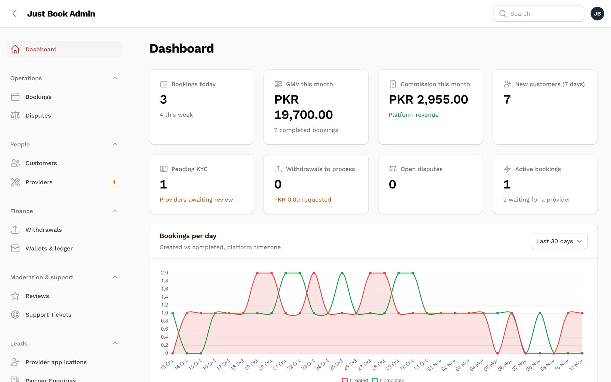
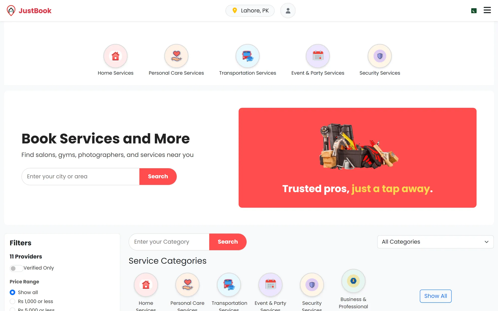
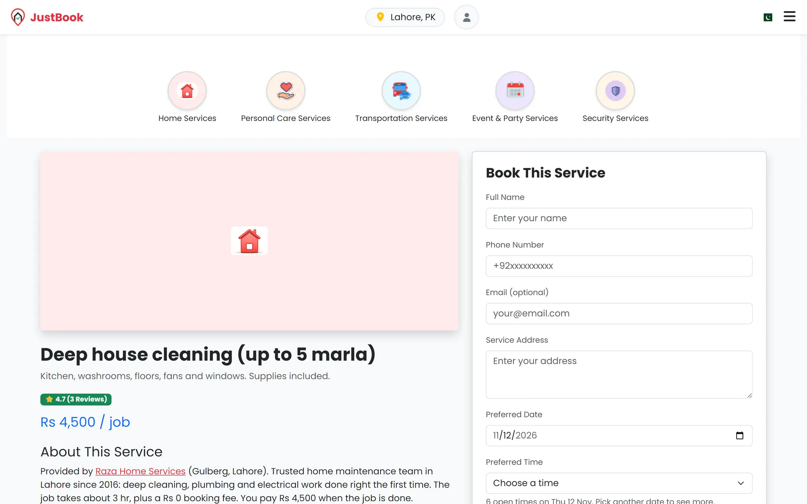
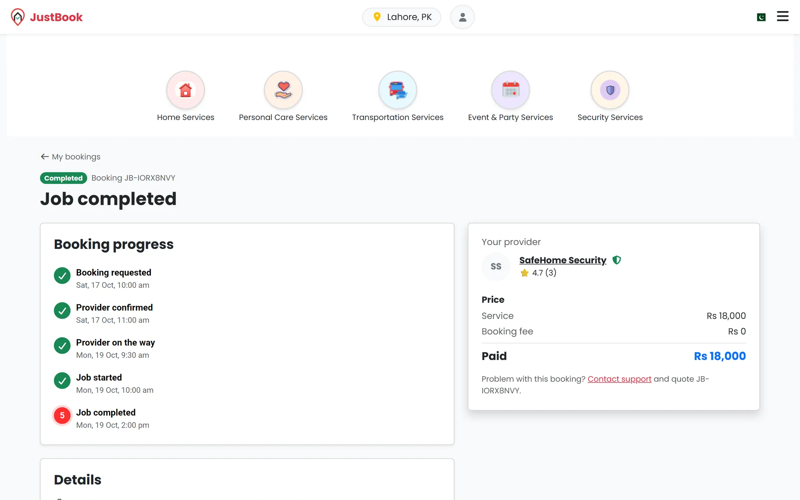
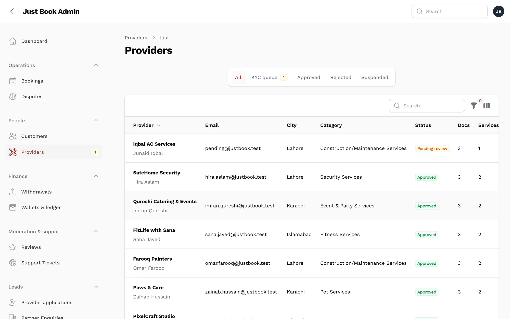
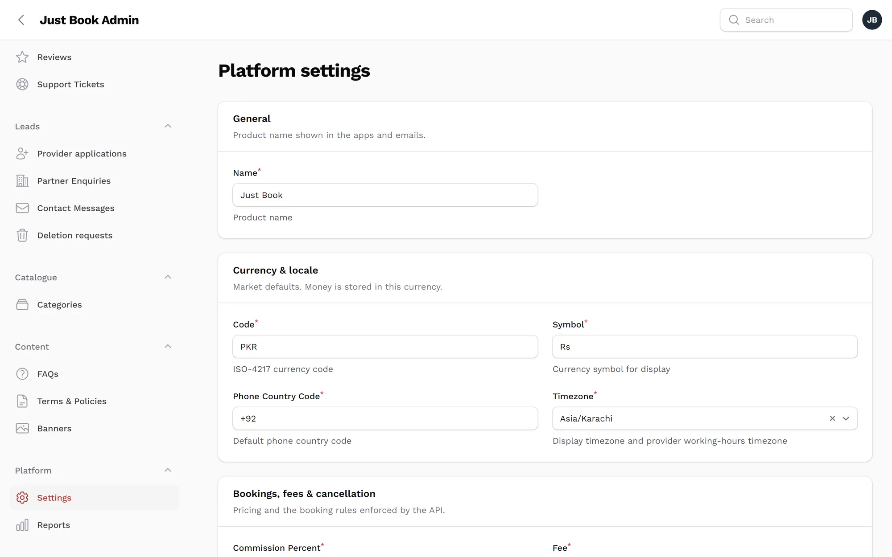
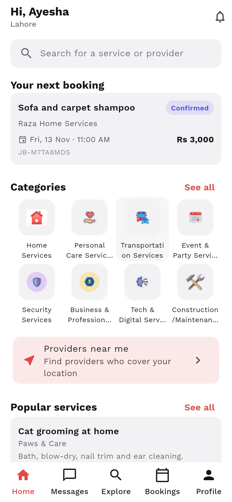
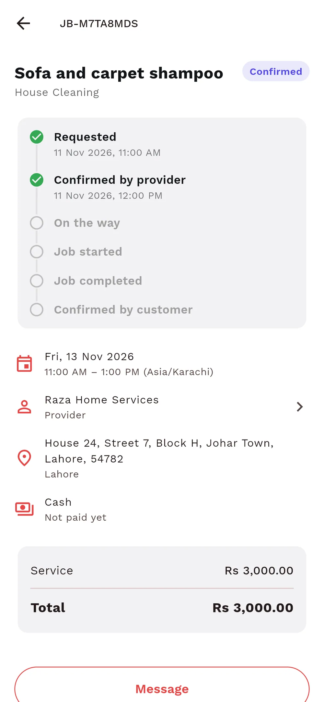
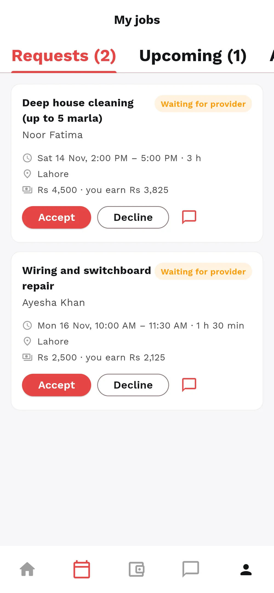
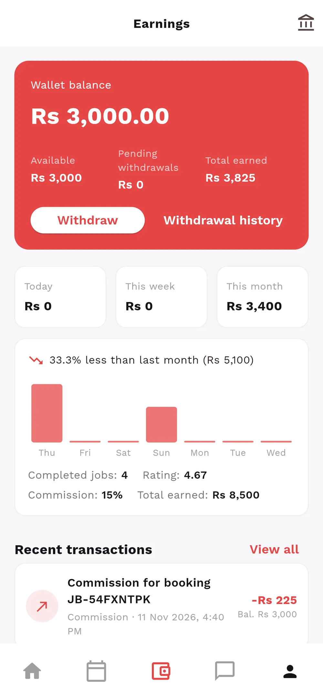

  

# Just Book

**A home-services marketplace where customers book verified providers, with one Flutter app, a Laravel API, an admin panel and websites.**

> **Portfolio showcase.** The source code is private. This repository presents the project with screenshots and a technical overview. Full case study: **[farhadnazir.com/projects/just-book](https://farhadnazir.com/projects/just-book/)**

| | |
|---|---|
| **Type** | Home-services booking marketplace |
| **Categories** | Mobile app, Web application, SaaS product, Business system |
| **Platforms** | Mobile, Web, Backend & API, Cross-platform |
| **My role** | Full-stack developer |
| **Status** | In development |
| **Timeline** | 2026 |

## Overview

Just Book is a two-sided marketplace for home and personal services. Customers find and book providers for cleaning, electrical work, tutoring, pet care and more, and providers manage their jobs, availability and earnings.

One Flutter app serves both roles, with a separate customer shell and provider shell. It talks to a Laravel 12 API that also powers a Filament admin panel, a business website and a customer booking website, so every surface runs on the same backend and the same business rules.

I rebuilt the backend, wrote the versioned API contract, built the admin panel and both websites, and rewired the app to the new API. The platform runs end to end in a local environment and is not yet deployed: payment gateway, SMS and store release depend on decisions from the client.

**Who it is for:** Customers who need home and personal services, independent providers and small service businesses, and the platform team that moderates providers, bookings and payouts.

## The problem

Our team inherited an existing Flutter app whose backend did not cover what the app needed. Screens after the booking step still ran on placeholder data, there was no admin panel and the websites were static HTML. A teammate imported the baseline code and documented the remaining work, and I took on the rebuild.

A booking marketplace also needs rules that a demo can skip: prices the customer cannot tamper with, slots that cannot be booked twice, a clear lifecycle for each job, and an accurate record of commission and provider earnings.

## The solution

I rebuilt the backend around a versioned /api/v1 contract with one response envelope, bearer-token auth, ownership policies and rate limiting. I put the domain logic in a service layer so the API, the booking website, the admin panel and scheduled jobs all reuse the same code.

I replaced the placeholder flows with a real booking lifecycle, server-side pricing, availability slots, a commission and wallet ledger, push notifications and realtime chat. Then I built the Filament admin panel, turned the client's HTML design into Blade business and booking websites, and connected the Flutter app through a shared API client with feature flags.

Integrations that still need client accounts, such as card payments, SMS OTP, social login and in-app calls, are switched off behind server-side feature flags, and payments and OTP delivery sit behind interfaces, so adding them later is a contained task.

## Key features

- **One app, two roles.** The same Flutter app has a customer shell (home, explore, bookings, messages, profile) and a provider shell (dashboard, jobs, earnings, messages, profile).
- **Server-side pricing.** The server quotes each booking with subtotal, booking fee, tax, discount, commission and provider earning, and snapshots the result on the booking. Amounts sent by the client are never trusted.
- **Availability and slot locking.** Providers set weekly availability rules and exceptions. Booking creation locks the provider and re-checks the slot inside a database transaction, and an idempotency key stops retried requests from creating duplicates.
- **Booking lifecycle.** Jobs move from pending to accepted or declined, then on the way, in progress, completed and customer-confirmed, with disputes and cancellation. A scheduler expires unanswered requests and auto-confirms completed jobs.
- **Providers near me.** Providers define service areas as a center and a radius of up to 50 km, and customers see only the providers who cover their location.
- **Commission and provider wallet.** Cash and pay-on-completion bookings post commission and earnings to a wallet ledger. Providers see their balance, weekly earnings and transactions, and request withdrawals that admins approve.
- **Provider onboarding and KYC.** Providers sign up, add services, pricing, service areas, availability and payout methods, and upload KYC documents for admin review. Document details are never exposed through the public API.
- **Realtime chat and notifications.** Customers and providers message each other over websockets, with polling as a fallback. Booking events trigger Firebase Cloud Messaging push notifications and fill an in-app inbox.
- **Admin panel.** A Filament panel with a KPI dashboard and screens for bookings, disputes, customers, providers, withdrawals, wallets, reviews, support tickets, leads and content, plus platform settings and CSV reports.
- **Business and booking websites.** A business website with become-a-provider and partner enquiry forms, and a /book site where customers browse services, pick live time slots, check out, track bookings and leave reviews.

## Screenshots

<table>
<tr>
<td width="50%" valign="top"> The /book website home, rebuilt in Blade from the client's design.</td>
<td width="50%" valign="top"> The /book website offers live time slots from the same availability rules.</td>
</tr>
<tr>
<td width="50%" valign="top"> Customers can track a booking on the web as well as in the app.</td>
<td width="50%" valign="top"> Admins review new providers in a KYC queue.</td>
</tr>
<tr>
<td width="50%" valign="top"> Market settings and commission rules are editable without a release.</td>
</tr>
</table>

<table>
<tr>
<td width="33%" valign="top" align="center"> Customer home in the Flutter app (demo data).</td>
<td width="33%" valign="top" align="center"> Each booking shows its progress through the lifecycle.</td>
<td width="33%" valign="top" align="center"> Providers accept or decline requests and see what they will earn.</td>
</tr>
<tr>
<td width="33%" valign="top" align="center"> The provider wallet is backed by the commission ledger.</td>
</tr>
</table>

## Architecture

Just Book is a monorepo with a Flutter app and a single Laravel 12 application. The Laravel app serves the versioned REST API, the Filament admin panel, the business website and the /book booking website. Domain logic lives in a shared service layer, so each surface calls the same booking, money and catalog code.

The Flutter app uses Provider for state, a shared dio API client with typed responses and errors, secure token storage, Google Maps for service areas and Firebase Cloud Messaging for push. The websites use Blade and Bootstrap 5. Data is stored in MySQL/MariaDB in development, with feature tests running on in-memory SQLite.

- **Contract-first API.** I documented the v1 API in a written contract before wiring the app. Every endpoint returns the same envelope (success, message, data, meta, errors), and API resources use explicit allow-lists of fields.
- **Booking state machine.** Booking statuses live in a single enum that defines which transitions each actor (customer, provider, admin, system) may make, so invalid moves are rejected in one place.
- **Safe concurrency and idempotency.** Slot booking uses a row lock and a re-check inside a transaction. Booking creation accepts an Idempotency-Key header, and ledger postings use deterministic references so settlement cannot run twice.
- **Portable geo search.** Coverage search narrows candidates with an indexed bounding box in SQL, then computes the exact Haversine distance in PHP. I chose this so the same code runs on MariaDB and on SQLite in tests.
- **Auth and roles.** Laravel Sanctum bearer tokens for the app, session auth for the booking website and Filament auth for admins. Providers move through pending review, approved, rejected and suspended states.
- **Built for pending integrations.** Payments and OTP delivery sit behind PaymentGateway and OtpChannel interfaces, starting with cash and email. Server-driven config publishes currency, phone code, timezone and feature flags, all editable in admin.
- **Realtime and background work.** Laravel Reverb broadcasts chat and booking updates, queued listeners send FCM push, and the scheduler handles expiry and auto-confirmation. The backend has feature tests and an end-to-end script that runs a booking against a real server.

## Tech stack

`Flutter` · `Dart` · `Laravel` · `PHP` · `Filament` · `MySQL` · `SQLite` · `Firebase` · `Laravel Reverb` · `Laravel Sanctum` · `Bootstrap` · `Google Maps`

## Links

- Case study: https://farhadnazir.com/projects/just-book/

## About the developer

Built by **Farhad Nazir**, full-stack software developer in Riyadh, Saudi Arabia, and founder of [Techwine Solutions](https://www.techwinesolutions.com). I build SaaS platforms, business systems, and mobile and desktop apps.

[Portfolio](https://farhadnazir.com) · [LinkedIn](https://www.linkedin.com/in/farhadnazir) · [Email](mailto:farhadnazirksa@gmail.com) · [WhatsApp](https://wa.me/966536566380)

---

Screenshots are shown for portfolio purposes. Rights to each product and its branding belong to their owners. Screens marked "recreated" use demo data, so no real customer data appears.
